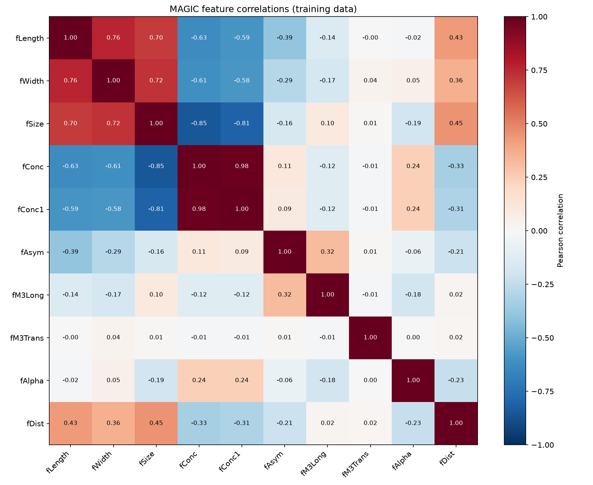

# MAGIC Gamma Telescope Classification

This project compares machine-learning classifiers on the MAGIC Gamma Telescope
dataset. The task is to distinguish gamma-ray signal events from hadron
background events using ten measurements derived from Cherenkov telescope
shower images.


## Dataset

The project expects `magic04.data` and its description, `magic04.names`, in
this folder. The data file contains 19,020 rows with ten numeric features and
one class label:

| Label in file | Meaning | Label used by the code |
|---|---|---:|
| `g` | Gamma-ray signal | 1 |
| `h` | Hadron background | 0 |

The ten features are `fLength`, `fWidth`, `fSize`, `fConc`, `fConc1`,
`fAsym`, `fM3Long`, `fM3Trans`, `fAlpha`, and `fDist`. They describe the
shape, size, and orientation of the shower image. The definitions and units
are documented in [`magic04.names`](./magic04.names).

The dataset documentation reports 12,332 gamma events and 6,688 hadron events.
It also warns that hadrons are underrepresented relative to real observations,
and that classifying background as signal is particularly costly. Therefore,
accuracy alone is not an adequate measure of scientific usefulness.

## Setup

From the repository root, create and activate a virtual environment and
install the project dependencies:

```powershell
py -m venv .venv
.\.venv\Scripts\Activate.ps1
python -m pip install -r requirements.txt
```

## Run the classifiers

Run commands from the repository root:

```powershell
python -m magic_telescope.tree_classifier
python -m magic_telescope.random_forest_classifier
python -m magic_telescope.gradient_boosting_classifier
python -m magic_telescope.svm_classifier
python -m magic_telescope.operating_points
```

Each script accepts an optional `--data-path` argument. For example:

```powershell
python -m magic_telescope.random_forest_classifier --data-path .\magic_telescope\magic04.data
```

The decision-tree script also saves a visualization to
`magic_telescope/outputs/decision_tree.png` and accepts `--plot-path` to
change its destination.

## Data preparation and evaluation

The four original classifier scripts provide exploratory comparisons. The
separate `operating_points` study below uses a different training/validation
protocol for model and threshold selection.

[`data_utils.py`](./data_utils.py) contains the shared data-loading, splitting,
and metric code. It:

1. Reads the headerless CSV using the ten feature names above and `class` as
   the target column.
2. Rejects missing files, empty datasets, unknown class labels, non-numeric
   features, and non-finite feature values.
3. Encodes `g` as 1 and `h` as 0.
4. Creates a reproducible 70/30 train/test split with stratification and
   `random_state=42`.

All models use the same split. The test set contains 5,706 events: 3,700
gamma events and 2,006 hadron events. Model fitting and hyperparameter search
use the training set; the reported metrics are computed on the held-out test
set.

The decision tree and Gradient Boosting scripts use five-fold cross-validation
on the training set, selecting parameters by ROC-AUC. The Random Forest is a
100-tree baseline and is not tuned. The SVM script compares linear and RBF
kernels at `C=0.1`, `1`, and `10`; it scales features inside a pipeline so
the scaler is fitted on training data only. The six SVM variants are
exploratory comparisons, not cross-validated hyperparameter selection.

The scripts report:

- **Accuracy:** fraction of all test events classified correctly.
- **Gamma precision:** among events predicted as gamma, the fraction that
  really are gamma.
- **Gamma recall:** among actual gamma events, the fraction identified.
- **ROC-AUC:** ranking ability across classification thresholds.
- **Confusion matrix:** rows are actual classes and columns are predicted
  classes, in the order hadron then gamma:

  ```text
  [[actual hadron predicted hadron, actual hadron predicted gamma],
   [actual gamma  predicted hadron, actual gamma  predicted gamma]]
  ```

The `actual hadron predicted gamma` entry is especially important: it counts
background events mistakenly accepted as gamma. Its rate in the last column
below is calculated among the 2,006 hadrons in this particular test set.

### Feature correlation



The heatmap shows Pearson correlations between the ten input features,
calculated over the 9,985 training events used by the operating-point study.
It combines gamma and hadron events and excludes its validation and test
sets. Red indicates positive linear association, blue negative association,
and values near zero little linear association. The diagonal is 1 because
each feature is perfectly correlated with itself.

For example, `fConc` and `fConc1` are strongly positively correlated
(`r = 0.98`), while `fSize` and `fConc` are strongly negatively correlated
(`r = -0.85`). These are descriptive observations about this training sample:
correlation does not establish causation, detect every nonlinear relationship,
or measure a feature's importance for classification. Similar features are
not automatically redundant for every classifier. No features were removed
based on this plot.

To regenerate the figure from the repository root:

```powershell
python -m magic_telescope.feature_correlation
```

The command accepts `--data-path` and `--plot-path` to use another dataset or
save the figure elsewhere.

## Results

The following are the results from one run with the settings above. Percentages
are rounded to two decimal places. They describe this fixed test split and
should not be interpreted as guaranteed performance on new observations.

| Model / settings | Accuracy | Gamma precision | Gamma recall | ROC-AUC | Hadrons predicted as gamma |
|---|---:|---:|---:|---:|---:|
| Decision Tree (`max_depth=None`, `min_samples_leaf=50`) | 84.56% | 85.19% | 92.22% | 0.8917 | 593 / 2,006 (29.56%) |
| Random Forest (`n_estimators=100`) | **88.33%** | 88.62% | 94.08% | **0.9351** | **447 / 2,006 (22.28%)** |
| Gradient Boosting (`n_estimators=200`, `learning_rate=0.1`, `max_depth=3`) | 88.00% | 87.62% | 94.89% | 0.9309 | 496 / 2,006 (24.73%) |
| SVM, linear (`C=0.1`) | 77.95% | 79.37% | 89.19% | 0.8231 | 858 / 2,006 (42.77%) |
| SVM, linear (`C=1`) | 77.97% | 79.37% | 89.22% | 0.8229 | 858 / 2,006 (42.77%) |
| SVM, linear (`C=10`) | 77.95% | 79.37% | 89.19% | 0.8229 | 858 / 2,006 (42.77%) |
| SVM, RBF (`C=0.1`) | 85.19% | 83.60% | **96.00%** | 0.9076 | 697 / 2,006 (34.75%) |
| SVM, RBF (`C=1`) | 86.65% | 85.38% | 95.81% | 0.9194 | 607 / 2,006 (30.26%) |
| SVM, RBF (`C=10`) | 87.47% | 86.13% | 96.16% | 0.9284 | 573 / 2,006 (28.56%) |

### Reading the results

On this split, the Random Forest has the highest ROC-AUC and accuracy among
the listed runs, and the lowest hadron-to-gamma error count. The RBF SVM
variants identify a larger fraction of gamma events (higher gamma recall),
but also misclassify more hadrons as gamma. This is a trade-off, not a single
universal ranking: the preferred model depends on the acceptable background
rate and the cost of each type of error.

The following study examines the low-hadron-acceptance operating points
recommended in the dataset description. A high overall ROC-AUC or gamma
recall at the default threshold alone does not demonstrate that a model
meets a required background rejection level.

## Low-background operating-point study

Run `python -m magic_telescope.operating_points` from the repository root.
The study keeps the original stratified 70/30 development/test split, then
splits the development data into 9,985 training and 3,329 validation events.
The test set contains 5,706 events. All splits use `random_state=42`.

- On the training set, three-fold stratified cross-validation selects among
  Decision Trees, Random Forests, Gradient Boosting, and RBF SVMs with the
  parameter choices printed by the script. SVM scaling is fitted within each
  training fold.
- The selection score is scikit-learn's **standardized partial ROC-AUC**
  over hadron acceptance rates from 0% to 20%. It weights that range rather
  than optimizing any one operating point. The fold standard deviations
  printed by the script describe variation across these folds, not confidence
  intervals; the best cross-validation score is also subject to selection
  optimism.
- The selected model is fitted on the training set only. For each requested
  acceptance rate, the validation scores determine the most permissive
  threshold with validation hadron acceptance at or below the target.
  Tied scores can make the achieved rate lower. Scores equal to the threshold
  are accepted as gamma.
- These fixed thresholds are then applied to the test set. The test hadron
  acceptance and gamma recall are reported separately with two-sided 95%
  Wilson intervals for the respective proportions.

For the supplied dataset, using scikit-learn 1.9.1 and NumPy 2.5.4, the selected
model was a 100-tree Random Forest with `min_samples_leaf=1`; its training CV
partial ROC-AUC was 0.8245 and its test ROC-AUC was 0.9350. Results may vary
with dependency versions. The output was:

| Target hadron acceptance | Threshold | Validation hadron acceptance | Test hadron acceptance (95% CI) | Test gamma recall (95% CI) |
|---:|---:|---:|---:|---:|
| 1% | 0.96 | 10/1,171 (0.85%) | 24/2,006 (1.20%; 0.81–1.77%) | 1,245/3,700 (33.65%; 32.14–35.19%) |
| 2% | 0.93 | 21/1,171 (1.79%) | 50/2,006 (2.49%; 1.90–3.27%) | 1,660/3,700 (44.86%; 43.27–46.47%) |
| 5% | 0.87 | 54/1,171 (4.61%) | 105/2,006 (5.23%; 4.34–6.30%) | 2,249/3,700 (60.78%; 59.20–62.34%) |
| 10% | 0.77 | 113/1,171 (9.65%) | 186/2,006 (9.27%; 8.08–10.62%) | 2,879/3,700 (77.81%; 76.44–79.12%) |
| 20% | 0.59 | 231/1,171 (19.73%) | 369/2,006 (18.39%; 16.76–20.15%) | 3,378/3,700 (91.30%; 90.35–92.16%) |

The target applies to the validation sample, not a guarantee on test or future
data: test acceptance exceeds the target at 1%, 2%, and 5% in this run.
Intervals describe binomial sampling uncertainty for a fixed fitted model
and threshold, assuming independent events; they do not include uncertainty
from model selection, training, or threshold selection. They are individual
intervals, not simultaneous guarantees.

Run all MAGIC tests from the repository root with:

```powershell
python -m unittest discover -s magic_telescope -p "test_*.py" -v
```

The tests cover data loading and splitting, correlation-plot generation, and
operating-point edge cases. GitHub Actions runs them on pushes and pull
requests.

## Limitations

- The supplied events are Monte Carlo generated, not a representative sample
  of real telescope observations.
- The hadron frequency in the file is known to be lower than in real data.
  Consequently, test-set precision and accuracy may not reflect real-world
  values.
- Results come from one split. The original model comparisons, especially
  the several SVM settings inspected on the same test set, are exploratory.
  The operating-point script does not use test labels for selection, but this
  same test split was already inspected in earlier comparisons; it is not a
  fresh independent final evaluation.
- No independent real-data validation has been performed.

These classifiers are suitable for learning and comparing methods on this
dataset. Independent validation on representative real observations would be
needed before drawing operational conclusions.

## Dataset reference

See [`magic04.names`](./magic04.names) for the dataset description, class
distribution warning, and prior-use references. The accompanying description
attributes the data to Monte Carlo simulations with CORSIKA and cites:

R. K. Bock et al. (2004), “Methods for multidimensional event classification:
a case study using images from a Cherenkov gamma-ray telescope,”
*Nuclear Instruments and Methods in Physics Research A*, 516, 511–528.

Bock, R. (2004). MAGIC Gamma Telescope [Dataset]. UCI Machine Learning Repository. https://doi.org/10.24432/C52C8B. Licensed under CC BY 4.0. The code maps class labels to numeric values.
